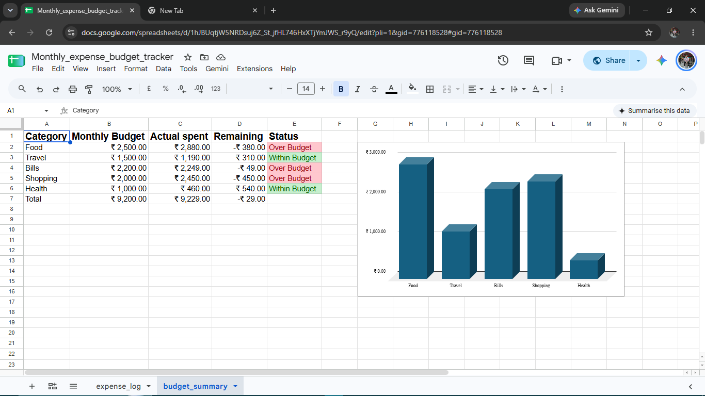
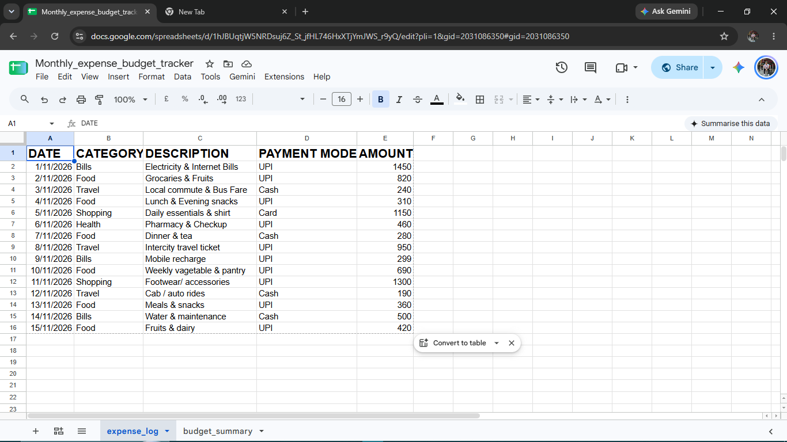

# Monthly Expense & Budget Tracker (Excel & Google Sheets)

A clean, automated spreadsheet tracker built to record daily expenses, compare actual spending against monthly category budgets, and flag budget overruns automatically.

## Live Preview
- **View Live Sheet:** [Open in Google Sheets](https://docs.google.com/spreadsheets/d/1hJBUqtjW5NRDsuj6Z_St_jfHL746HxXTjYmJWS_r9yQ/edit?pli=1&gid=776118528#gid=776118528)

## Key Features
- **Two-Tab Structure:** Separate `expense_log` for daily entries and `budget_summary` for automated reporting.
- **Dynamic Formulas:** Uses `SUMIFS`, `IF`, and `SUM` to calculate category-wise spending, remaining balance, and budget status (`Within Budget` / `Over Budget`).
- **Conditional Formatting:** Highlights `Over Budget` categories in red and `Within Budget` categories in green for quick visual review.

## Preview

## Tools Used
- Microsoft Excel
- Google Sheets
